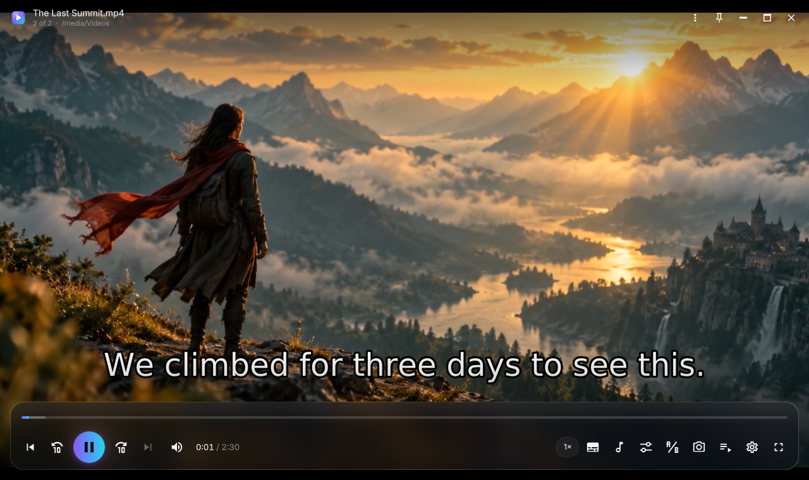
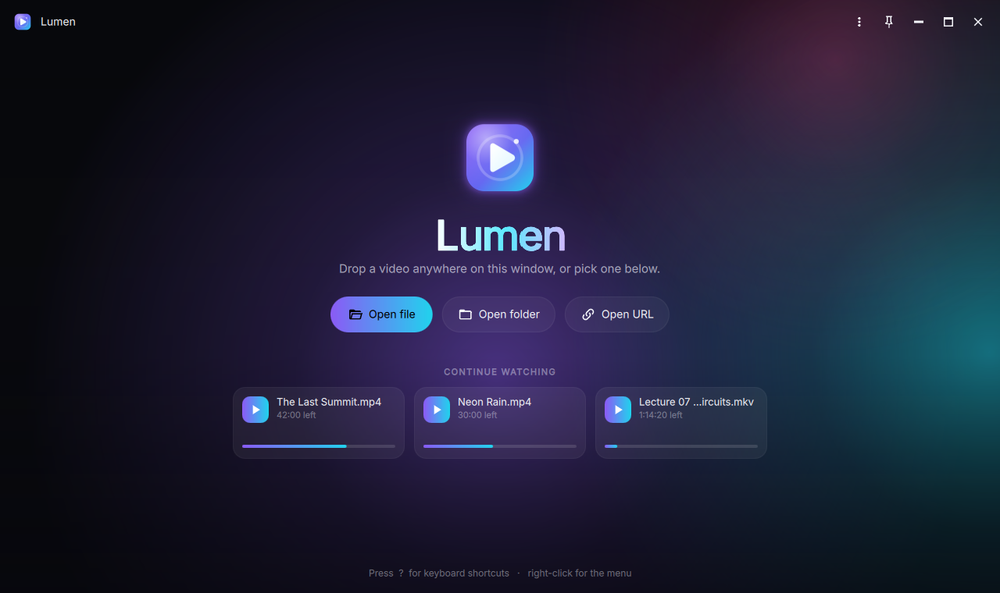
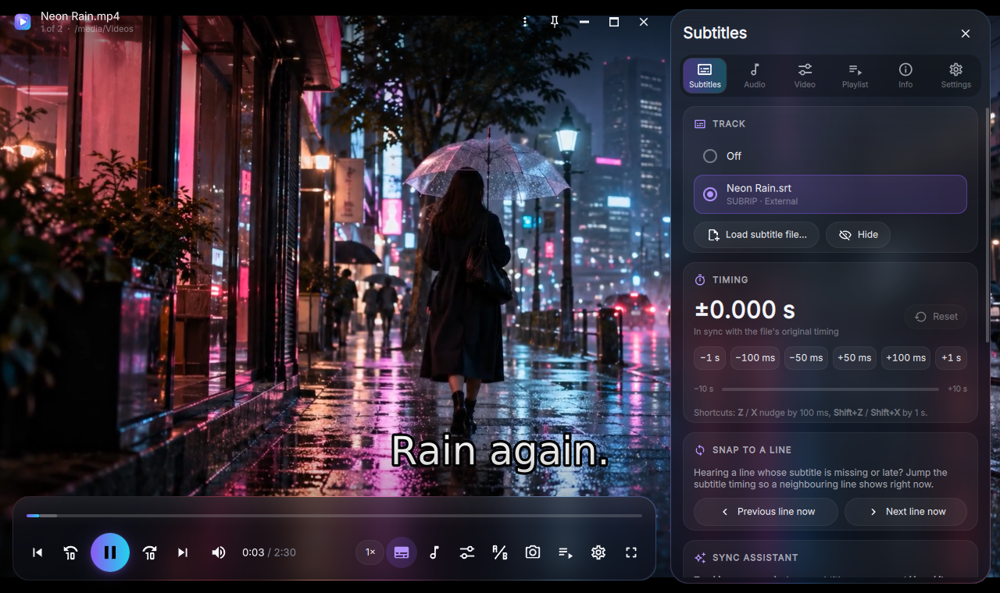
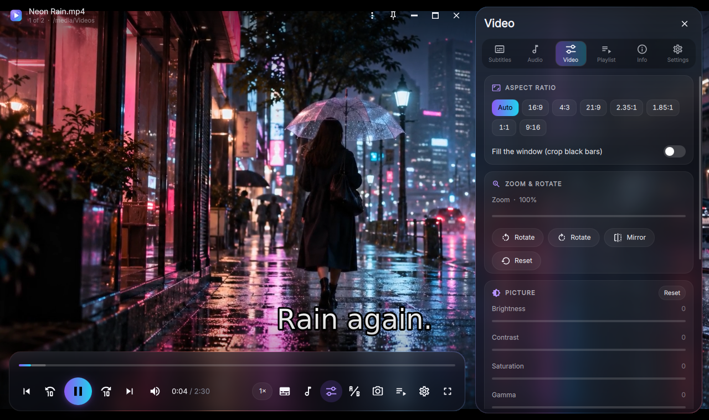
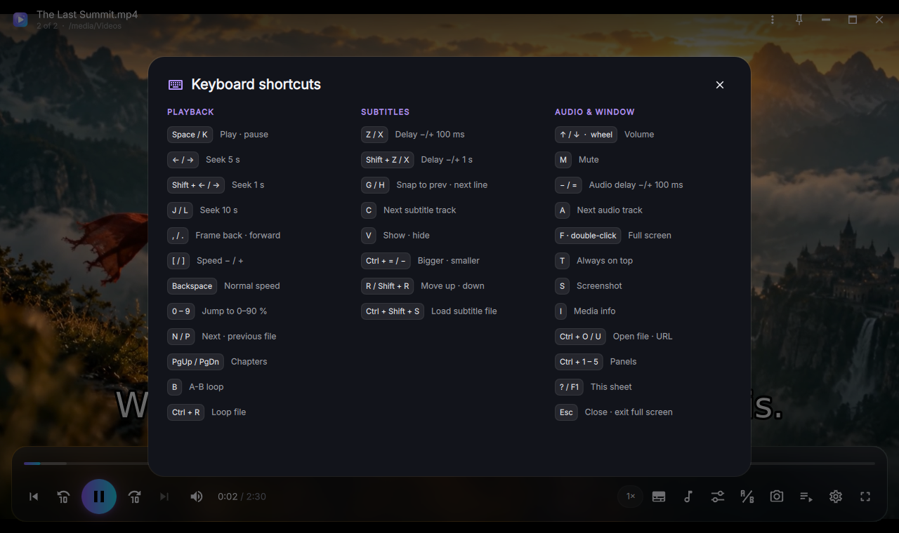
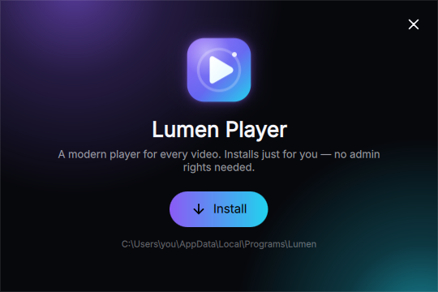

<p align="center">
  
</p>

<h1 align="center">Lumen Player</h1>

<p align="center">
  <b>A modern, animated video player for Windows, built on mpv.</b><br>
  Plays almost any file, looks good doing it, and makes out-of-sync subtitles easy to fix.
</p>

<p align="center">
  <a href="https://github.com/SaraAminpour/lumen-player/releases/latest"></a>
  
  
  <a href="LICENSE"></a>
</p>

<p align="center">
  <a href="https://github.com/SaraAminpour/lumen-player/releases/latest"><b>⬇ Download for Windows</b></a>
  &nbsp;·&nbsp; <a href="#installation">Installation</a>
  &nbsp;·&nbsp; <a href="#fixing-subtitle-timing">Subtitle sync</a>
  &nbsp;·&nbsp; <a href="#keyboard-shortcuts">Shortcuts</a>
  &nbsp;·&nbsp; <a href="#building-from-source">Build</a>
</p>

<p align="center">
  
</p>

## About

Lumen is a desktop video player that pairs the playback engine of [mpv](https://mpv.io) with a fluid,
modern interface written in Qt Quick. mpv decodes almost every format and codec, has excellent
hardware acceleration, and renders subtitles beautifully. Lumen wraps it in an interface that is
quick to learn: glassy panels, smooth animations, and controls that get out of the way while you watch.

Lumen grew out of a simple frustration: downloaded subtitles that run a second early or late. The usual
fix in most players is a hidden menu and trial and error. In Lumen, subtitle timing has its own panel,
with one-tap nudges, a "snap to line" button, and a sync assistant that works out the right delay for you.

## Highlights

- **Plays everything mpv plays:** MKV, MP4, AVI, MOV, WebM, TS and more, with HEVC, AV1, VP9, HDR and
  multi-track audio. Hardware decoding is on by default.
- **Subtitle sync tools** that turn a fiddly job into a few clicks (see [below](#fixing-subtitle-timing)).
- **Dual subtitles:** show a second language at the top of the screen, which is great for learning.
- **Picks up where you left off:** remembers position, tracks and delays per file, and keeps a
  *Continue watching* list on the home screen.
- **Binge-friendly:** opening an episode queues the rest of the folder, in natural order.
- **Seek-bar previews:** hover over the timeline to see a thumbnail of that moment.
- **Clean full screen:** controls hide after 3 seconds without mouse movement. A double-click toggles
  full screen instantly.
- **Click to clear the view:** a single click hides or shows the controls without touching playback, so a
  paused frame can be seen edge to edge. Playing and pausing stay on <kbd>Space</kbd> and the play button.
- **Native Windows integration:** "Open with" entry, Desktop and Start menu shortcuts, single-instance
  opening, dark title bar and rounded corners.
- **Installs without admin rights** and uninstalls cleanly from *Settings → Apps*.

<table>
  <tr>
    <td width="50%"></td>
    <td width="50%"></td>
  </tr>
  <tr>
    <td align="center"><sub>Home screen with <i>Continue watching</i></sub></td>
    <td align="center"><sub>Subtitle panel: tracks, timing, snap to line, sync assistant</sub></td>
  </tr>
  <tr>
    <td width="50%"></td>
    <td width="50%"></td>
  </tr>
  <tr>
    <td align="center"><sub>Picture: aspect ratio, zoom, rotate, colour, sharpen, deband</sub></td>
    <td align="center"><sub>Every shortcut on one sheet (press <kbd>?</kbd>)</sub></td>
  </tr>
</table>

## Features

| Area | What you get |
|---|---|
| **Playback** | Play/pause, ±1/5/10 s seeking, frame stepping, chapters, speed 0.25×–4× with pitch correction, A-B loop, file loop, playlist loop and shuffle |
| **Subtitles** | Track picker, external `.srt` `.ass` `.ssa` `.vtt` `.sub` `.sup` `.idx` files (drag and drop works), ±50 ms to ±1 s nudges, snap to previous/next line, sync assistant, second subtitle, size, position, colour, background box, override for styled (ASS) subtitles |
| **Audio** | Track picker, external audio files, audio delay, volume boost up to 200%, loudness normalization, stereo downmix for 5.1/7.1, output device selection |
| **Picture** | Aspect ratio presets, crop to fill, zoom, rotate, mirror, brightness, contrast, saturation, gamma, sharpening, debanding, deinterlacing, hardware/software decoding |
| **Library** | Continue watching, auto-queued folder playback, playlist panel, open files, folders or URLs (direct media links) |
| **Tools** | Screenshots with or without subtitles, media info (codecs, bitrate, resolution, colour, dropped frames), always on top |
| **Look** | Several accent colours, frosted-glass panels (can be turned off on slow PCs), animated home screen |

## Installation

### Installer (recommended)

1. Download **`Lumen-Setup-<version>.exe`** from the [latest release](https://github.com/SaraAminpour/lumen-player/releases/latest).
2. Run it and click **Install**. Lumen installs for the current user only, so no administrator
   rights are needed.
3. Open Lumen from the Desktop or Start menu, or right-click any video → **Open with** → **Lumen Player**.

<p align="center"></p>

The installer puts Lumen in `%LOCALAPPDATA%\Programs\Lumen` and adds:

- Desktop and Start menu shortcuts
- a **Lumen Player** entry in Explorer's *Open with* menu for common video and audio formats
- an entry in *Settings → Apps → Installed apps*, so Lumen can be uninstalled like any other app

To update, run the newer installer. It replaces the old version in place and closes Lumen first if it is
open. Your settings and watch history are kept.

> **Windows SmartScreen.** The installer is not code-signed yet, so Windows may show *"Windows protected
> your PC"* the first time. Click **More info** → **Run anyway**.

**Silent install** (for scripts): `Lumen-Setup-<version>.exe /S`

### Portable

Prefer not to install anything? Download **`Lumen-Player-<version>-win64-portable.zip`**, extract it
anywhere (a USB stick works), and run `Lumen.exe`. Running `Install Lumen.exe` from that folder installs
it later if you change your mind.

### Making Lumen the default player

Windows only lets you choose the default app yourself: right-click a video → **Open with** →
**Choose another app** → **Lumen Player**, and tick **Always use this app**.

### Uninstalling

*Settings → Apps → Installed apps → Lumen Player → Uninstall.* Shortcuts, the *Open with* entry and the
program folder are removed. Silent uninstall: `"%LOCALAPPDATA%\Programs\Lumen\Lumen.exe" --uninstall --quiet`

### Requirements

- Windows 10 or 11, 64-bit
- A GPU with OpenGL 3.3 (any Intel, AMD or NVIDIA GPU from the last decade)
- About 260 MB of disk space

## Fixing subtitle timing

Open the **Subtitles** panel (<kbd>Ctrl</kbd>+<kbd>1</kbd>, or the subtitle button in the control bar).
Three tools cover almost every case:

1. **Nudge.** If the subtitles are early or late by a roughly known amount, tap **−1 s / −100 ms / −50 ms**
   or **+50 ms / +100 ms / +1 s**, or use <kbd>Z</kbd> / <kbd>X</kbd> (100 ms) and
   <kbd>Shift</kbd>+<kbd>Z</kbd> / <kbd>Shift</kbd>+<kbd>X</kbd> (1 s) without opening the panel.
   *Positive values show subtitles later.*
2. **Snap to a line.** When you hear a line but its subtitle is missing or still on the previous line, press
   <kbd>G</kbd> (previous line now) or <kbd>H</kbd> (next line now). Lumen shifts the timing so that line
   appears right now.
3. **Sync assistant.** Tap **Line appeared** when a subtitle pops up and **Heard it** when that line is
   actually spoken, in either order. Lumen shifts the subtitles by the difference.

The delay is shown live (for example `+1.250 s`), saved per file, and reset with one click. Audio that
drifts from the picture has the same controls in the **Audio** panel.

## Keyboard shortcuts

Press <kbd>?</kbd> or <kbd>F1</kbd> in the app to see them all. The most useful:

| Playback | | Subtitles | | Window | |
|---|---|---|---|---|---|
| <kbd>Space</kbd> / <kbd>K</kbd> | Play / pause | <kbd>Z</kbd> / <kbd>X</kbd> | Delay −/+ 100 ms | <kbd>F</kbd> / double-click | Full screen |
| <kbd>←</kbd> / <kbd>→</kbd> | Seek 5 s | <kbd>Shift</kbd>+<kbd>Z</kbd> / <kbd>X</kbd> | Delay −/+ 1 s | <kbd>Esc</kbd> | Exit full screen |
| <kbd>J</kbd> / <kbd>L</kbd> | Seek 10 s | <kbd>G</kbd> / <kbd>H</kbd> | Snap to prev / next line | <kbd>T</kbd> | Always on top |
| <kbd>,</kbd> / <kbd>.</kbd> | Frame back / forward | <kbd>C</kbd> | Next subtitle track | <kbd>↑</kbd> / <kbd>↓</kbd> / wheel | Volume |
| <kbd>[</kbd> / <kbd>]</kbd> | Speed −/+ | <kbd>V</kbd> | Show / hide | <kbd>M</kbd> | Mute |
| <kbd>N</kbd> / <kbd>P</kbd> | Next / previous file | <kbd>Ctrl</kbd>+<kbd>=</kbd> / <kbd>−</kbd> | Bigger / smaller | <kbd>S</kbd> | Screenshot |
| <kbd>B</kbd> | A-B loop | <kbd>R</kbd> / <kbd>Shift</kbd>+<kbd>R</kbd> | Move up / down | <kbd>I</kbd> | Media info |
| <kbd>0</kbd>–<kbd>9</kbd> | Jump to 0–90 % | <kbd>Ctrl</kbd>+<kbd>Shift</kbd>+<kbd>S</kbd> | Load subtitle file | <kbd>Ctrl</kbd>+<kbd>O</kbd> / <kbd>U</kbd> | Open file / URL |

A single click on the video shows or hides the controls; right-click anywhere on the video for a menu with everything else.

## How it works

```
┌──────────────────────────────────────────────┐
│  Qt Quick / QML interface (app/lumen/qml)    │  panels, animations, input
├──────────────────────────────────────────────┤
│  Python glue (PySide6)                       │  main.py · mpvcore.py · installer.py
├──────────────────────────────────────────────┤
│  libmpv via the OpenGL render API            │  decoding, filters, subtitles (libass)
└──────────────────────────────────────────────┘
```

- **Rendering.** `mpvcore.VideoItem` is a `QQuickFramebufferObject`. mpv draws each frame into a Qt-owned
  OpenGL framebuffer, so the video sits inside the Qt Quick scene and the glass panels can blur it live.
- **State.** `mpvcore.Player` observes mpv properties (position, tracks, delays and so on) and exposes them
  to QML as Qt properties, so the interface updates through bindings.
- **Launcher.** `Lumen.exe` is a small C program (`launcher/launcher.c`) that loads the bundled embeddable
  Python and runs `app\lumen\main.py`, so there is no console window and no system Python is required.
- **Installer.** Renaming the same launcher to `Install Lumen.exe` switches Lumen into installer mode
  (`installer.py` + `Installer.qml`). `Lumen-Setup.exe` is a small NSIS wrapper that unpacks the bundle to
  a temporary folder and starts that installer. Installs copy to a side folder first and then swap, so a
  failed update never leaves a half-installed player.
- **Full screen on Windows** uses a borderless window one pixel taller than the monitor. A window that
  exactly covers the screen makes some GPU drivers switch to exclusive full-screen mode, which freezes
  playback for several seconds on hybrid-GPU laptops.

## Building from source

The Windows release is cross-built on Linux (tested on Ubuntu 22.04).

```bash
sudo apt install mingw-w64 nsis zip p7zip-full python3-pip
git clone https://github.com/SaraAminpour/lumen-player.git
cd lumen-player
packaging/fetch-deps.sh   # embeddable Python 3.13, PySide6 6.12 wheels, python-mpv, libmpv (shinchiro build)
./build.sh                # → build/Lumen-Setup-<version>.exe and build/Lumen-Player-<version>-win64-portable.zip
```

`packaging/make-bundle.sh` assembles the runtime and keeps only the ~460 of PySide6's ~2,500 files that
Lumen actually loads (`packaging/keep-pyside6.txt`). Pass `--clean` to `build.sh` to rebuild the runtime
from scratch.

### Running from source (development)

Lumen also runs on Linux, which makes UI work quick:

```bash
sudo apt install libmpv2           # or your distribution's libmpv package
python3 -m venv .venv && .venv/bin/pip install PySide6==6.12.0 python-mpv==1.0.8
.venv/bin/python app/lumen/main.py --new-window path/to/video.mkv
```

### Project layout

```
app/lumen/
  main.py          app start-up, Windows integration, single-instance server
  mpvcore.py       libmpv player object, OpenGL video item, seek-bar thumbnailer
  installer.py     per-user install / uninstall
  qml/             the whole interface (Main.qml, panels, controls, Theme.qml)
  assets/          logo and Inter font
launcher/          Lumen.exe source (C, mingw-w64)
packaging/         dependency download, bundle assembly, NSIS setup script
docs/screenshots/  images used in this README
```

## Contributing

Bug reports and ideas are welcome in [Issues](https://github.com/SaraAminpour/lumen-player/issues).
Please include your Windows version, GPU, and the log from **Settings → Help → Open log**.

## License

Lumen Player is free software, released under the [GNU General Public License v3.0](LICENSE).
It bundles mpv/FFmpeg (GPL), Qt/PySide6 (LGPL), Python (PSF), the Inter typeface (OFL) and Material
Design Icons (Apache-2.0); see [THIRD-PARTY-NOTICES.md](THIRD-PARTY-NOTICES.md).

<p align="center"><sub>Made by <a href="https://github.com/SaraAminpour">Sara Aminpour</a></sub></p>
